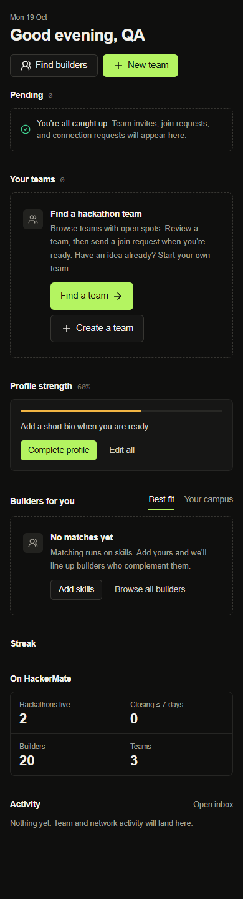

# First-team activation verification

Verified locally October 19, 2026 against main `432e76c`, on isolated branch `feat/first-team-activation`.

Before: the existing teamless dashboard state emphasizes creating a team; browsing is secondary. After: Find a team is primary, with explicit guidance to review a recruiting team and send a join request. Creating a team remains available. This replaces the existing state and adds no dashboard section, onboarding step or automatic request.

## Results

| Check | Result |
| --- | --- |
| Actual React page/hook tests for dashboard, join requests, onboarding saves, OAuth callback/return paths, discovery and creation | **424 passed**, 0 failed/skipped |
| Desktop (1440px) and mobile (390px) browser checks using real components and application CSS | **14 passed**, 0 external requests |
| TypeScript | `npx tsc --noEmit` passed |
| Whitespace/diff check | `git diff --check` passed |
| Scoped ESLint | No new diagnostics. Full scoped command still exits 1 for the pre-existing `prefer-const` error on `finalCampus` in `useDashboardData.ts`; DashboardView also has four pre-existing unused imports. Compared diagnostic rule/severity/message against the pinned baseline using ESLint's API. |

The browser path exercises keyboard activation of Find a team → real TeamsView → real team detail page/TeamOverviewView → explicit synthetic Request to join. It asserts zero mutations before that final click, exactly one request/event afterward, no visitor management controls, preserved existing-user workspace links, prompt suppression for incomplete/loading/refresh/error states, 44px mobile action targets and no horizontal overflow. The create link's destination and enum analytics are checked without submitting a form; existing creation tests exercise the form separately.

The dashboard hook tests cover failed member/owner/profile reads, visible Retry and recovery, an in-flight refresh, existing owner/member users, incomplete-onboarding redirection, privacy-minimal click payloads, Strict Mode and reload impression deduplication. Join analytics tests cover success, duplicate/permission failure, already-member and logged-out preflights. Existing onboarding and Google/GitHub OAuth tests preserve team/profile/event/invitation deep links, query strings/fragments and callback cookies without replaying join, invite or connection actions.

## Screenshots

Inspected all four images. All data is synthetic. These are isolated component screenshots, not production screenshots. Both versions use application CSS and system-font substitutes for the Next-managed Google fonts, with unrelated widgets excluded identically. Before source is pinned to main `432e76c`.

| View | Before | After |
| --- | --- | --- |
| Desktop | [Before desktop](before-desktop.png) | [After desktop](after-desktop.png) |
| Mobile | [Before mobile](before-mobile.png) | [After mobile](after-mobile.png) |



Machine-readable browser results: [browser-results.json](browser-results.json).

## Reproduce

With the repository's locked dependencies installed:

```powershell
npx tsc --noEmit
node --test --test-timeout=45000 --test-reporter=spec scripts/test-dashboard-join-requests.cjs scripts/test-first-team-request-analytics.cjs scripts/test-onboarding-submission.cjs scripts/test-auth-return-ui.cjs scripts/test-auth-return-paths.cjs scripts/test-team-discovery.cjs scripts/test-team-creation.cjs
node scripts/test-first-team-activation-browser.cjs
```

The screenshot runner uses a fresh headless Edge context, binds to a random loopback port, blocks external browser requests and closes the server/browser in `finally`. Edge must already be installed. Its in-memory adapters accept only the synthetic join RPC; unexpected writes fail. No application environment files, live sessions or database credentials are loaded. The historical `test-auth-browsing-compatibility.cjs` requires separate pinned PR #21/suspension checkouts and was not part of the passing suite; current callback, login and onboarding runtime tests provide the relevant return-path coverage.

## Limits, measurement and risk

No live Supabase query/write, account creation, OAuth provider exchange, GA ingestion, migration, deployment or environment change was performed. Fixtures do not prove deployed RLS, middleware or external service delivery. No paid API or dependency was added. Actual conversion improvement remains unproven until a separately approved release and sufficient follow-up data.

The new events are `first_team_prompt_shown`, `first_team_prompt_selected` (join/create enum), and success-only `team_join_request_sent`. Their only properties are fixed source/path values. They add no personal content or entity IDs, use the existing bridge, and do not duplicate existing onboarding/team-created/connection events. Shown means rendered once per viewer per mounted dashboard, not verified viewport visibility or a lifetime first visit. Returning users with no current team are eligible. Use distinct-user ordered funnels and existing outcome events; do not call clicks or signup completion activation.

Risk is low: the change alters only empty-state priority/copy, safe team-refresh presentation and additive analytics. Recruiting inventory, analytics blocking and team response rates can limit impact. A route or prompt click sends no join, invite or connection request. Revert the frontend changes to roll back; no database cleanup is needed. Hustle Carnival implementation files and behavior are untouched.
