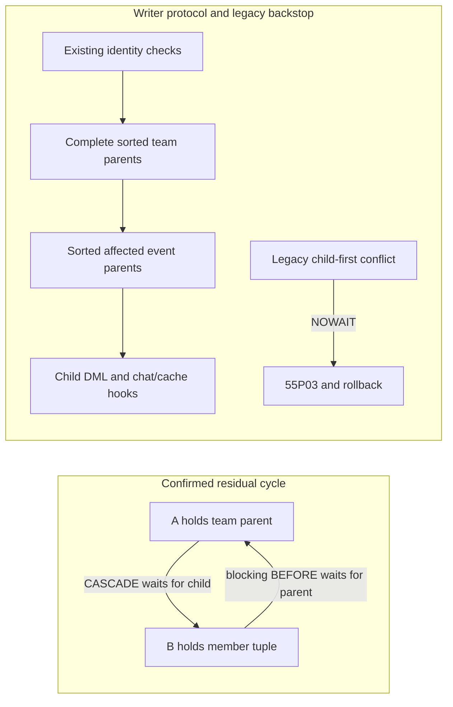

# C1 final locking qualification — review only

Baseline: Draft PR #93 at `f7845bc5993a8145782b1d614c62a391c1012081`, stacked on unchanged Draft #92 at `4818052a944451c74ae0a7d7c4572f3e7c3d0f8e`. No existing database connection or data/configuration change. All new SQL is a **C2 writer prototype under docs**, not an active migration. The application adapter is not implemented here. [README](README.md) contains final counts, inventory and limitations.

## Authoritative facts and model provenance

The founder's independent read-only catalog inspection confirms production PostgreSQL **17.6** and these CASCADE FKs:

| Child | Referenced parent / action |
|---|---|
| hackathon_registrations.team_id | teams.id ON DELETE CASCADE |
| team_members.team_id | teams.id ON DELETE CASCADE |
| team_members.user_id | profiles.id ON DELETE CASCADE |
| conversations.team_id | teams.id ON DELETE CASCADE |
| conversation_participants.conversation_id | conversations.id ON DELETE CASCADE |
| conversation_participants.user_id | auth.users.id ON DELETE CASCADE |

Membership CASCADE is **production-confirmed**, not a hypothetical fixture variation. No FK change is proposed. Team deletion removes registrations, memberships, conversations and participants, and releases confirmed registration-row slots; no history preservation or automatic waitlist promotion is promised. Profiles→Auth and ancillary fixture FK assumptions follow the repository's existing user-deletion fixture; the six rows above are specifically founder-confirmed, not inferred from that fixture.

Founder-confirmed trigger owners are postgres, SECURITY DEFINER, search_path=public,pg_temp. The local model uses the supplied exact create-conversation body and supplied INSERT/DELETE member behaviors: select first team conversation; INSERT participant ON CONFLICT(conversation_id,user_id) DO NOTHING; DELETE matching participant. The removal body and profile audit body also exist in repository migrations. All execute in the caller's transaction.

| Trigger | Dependency / locking implication |
|---|---|
| teams.trg_create_team_conversation AFTER INSERT | Inserts unique team conversation, ON CONFLICT(team_id) DO NOTHING. New team belongs to creating transaction. |
| team_members.trg_add_member_to_team_conversation AFTER INSERT | Participant insert takes FK/unique-key locks; parent pre-lock must precede member insertion. |
| team_members.trg_remove_member_from_team_conversation AFTER DELETE | Removes participant; can wait for an existing participant UPDATE. |
| team_members.matchmaking_member_changed AFTER INSERT/DELETE/UPDATE(team_id,user_id,project_role) | Real `20260925221500_matchmaking_v2_engine.sql` is loaded, including sorted affected IDs, parent NO KEY UPDATE, feature/feed maintenance. |
| teams.matchmaking_team_changed AFTER INSERT/selected UPDATE | Existing parent tuple is already held; refresh takes a reentrant parent lock. |
| profiles.matchmaking_profile_changed AFTER INSERT/selected UPDATE | Starts with profile tuple, then refreshes related team parents in sorted order. Important late-account-lock constraint below. |
| profiles.on_profile_before_delete BEFORE DELETE | Real `202608030005_add_deleted_user_logs_audit_trigger.sql` suppresses audit-insert errors. Real deletion RPC independently requires the audit row; tests inject audit failure and demand full rollback. |

The supplied behavior is sufficient to model these edges, not a byte-for-byte dump of every live function/ACL/policy. Full deployed definitions, inherited grants and other dependent tables still need a separately authorized acceptance comparison before release.

## Writer audit

[LOCK-QUERY-INVENTORY.json](LOCK-QUERY-INVENTORY.json) records **94 API query chains** (every requested projection/filter/write argument) and **366 verbatim SQL contexts** at the immutable baseline. It supplements the original registration/hackathon inventory. Reproduce with `node scripts/mission20-c1-locking-inventory.cjs --check`. Historical/fixture statements are included as context, not treated as current deployed writers. Exactly **13 direct application mutation chains** affect the audited tables:

| Application file / baseline line | Exact mutation fields / filters | Protocol treatment |
|---|---|---|
| src/app/teams/[id]/page.tsx:297 | team_members DELETE by id,team_id; returns id | Prototype invoker remove RPC pre-locks team, then retains actual ACL/RLS. UI owner/self gates and one-row confirmation must remain in C2. |
| src/components/TeamOverviewView.tsx:227 | team_members UPDATE project_role by id | Prototype invoker role RPC adds parent+team scope; preserves actual UPDATE policies. No policy is added to make a denied update work. |
| src/app/teams/[id]/page.tsx:296 | teams DELETE by id,owner_id; returns id | Prototype invoker delete RPC: parent, sorted linked events, then DML/CASCADE. Retain UI owner gate. |
| src/app/admin/_tabs/TeamsTab.tsx:30 | teams DELETE by id | Same invoker protocol, never service-role escalation. Actual admin DELETE entitlement must be verified; the fixture owner-only policy denies a non-owner. |
| src/app/hackathons/[id]/page.tsx:541,579,642 | teams UPDATE is_recruiting / hackathon_id by team ID (579 also owner_id) | Single-parent UPDATE already obtains its team tuple before AFTER triggers. Preserve existing ownership/RLS checks. |
| src/app/teams/[id]/page.tsx:340 | teams UPDATE is_recruiting by id | Same single-parent rule. |
| src/components/TeamOverviewView.tsx:275 | teams UPDATE name,description,college,max_members,skills,roles_needed by id | Same; affected feature refresh is reentrant. |
| src/components/TeamWorkspaceView.tsx:214,256 | teams UPDATE github_repo_url (value / NULL) by id | Same; no new authorizing grants. |
| src/components/partners/LegacyPartnerPage.tsx:254 | teams UPDATE description by id | Same; partner scope/permissions retained. |
| src/components/chatThread.tsx:1337 | conversation_participants UPDATE cleared_at by conversation_id,user_id | Existing single-statement personal clear may hold a child tuple. It must not subsequently acquire team/event parents in the same transaction. Tested against team CASCADE and transfer; no CP grant/policy change. |

There are no direct application team/team-member INSERT/UPSERT chains. Current database workflows:

| Entry point / repository-effective definition | Existing authorization and lock issue / correction |
|---|---|
| create_team_with_owner — `202607080007_team_multiple_hackathons.sql` | Authenticated caller, required fields, 2–20 size; creates team owned by caller then owner membership/link. Uncommitted new parent precedes children. No body change. Caller: teams/create/page.tsx:244. |
| add_user_to_team — `20260928100000_phase1a_definer_function_privileges.sql:104` | Already locks parent before count/insert. Member role only, owner-or-self check, capacity/duplicate checks. No API-role EXECUTE. No body/ACL change. |
| accept_team_invite — `202607020001_core_security.sql` | Pending invitation for current invited user; used in invites/page.tsx:115, dashboard/useDashboardData.ts:611, TeamOverviewView.tsx:195, chatThread.tsx:147. Originally locks invitation before parent helper. Proposal does authorized nonlocking lookup, parent lock, then **unchanged original pending/caller lookup FOR UPDATE** and body. |
| accept_team_join_request — same core migration | Pending request and current team owner; requests/page.tsx:137 and dashboard/useDashboardData.ts:580. Same parent-before-request correction, with original authorization rechecked after locking. |
| join_team_instantly(uuid,text) — `202607270002_fix_join_team_instantly_race_condition.sql` | Signed Vault HMAC/team/expiry/auth checks; already parent FOR UPDATE before add helper and invite/request cleanup. Caller teams/[id]/page.tsx:131. Preserve signature/token checks; no weaker replacement or live token operation. |
| ensure_team_conversation — `202607070001_ensure_team_conversation.sql` | Membership check; caller TeamWorkspaceView.tsx:1003. Add parent lock and membership recheck before conversation/participant DML. |
| delete_user_completely — `202610060001_restore_safe_user_deletion.sql` | Current caller/target identity, self/admin/founder/protected-admin, storage and audit checks remain. Used by api/admin/delete-user/route.ts:59, profile/[id]/useProfileData.ts:424 and settings/DeleteAccountSection.tsx:31. Previously pre-locks owned teams only; proposal gathers **owned + non-owned membership + registration-linked teams**, then all affected events in one sorted union before child DML/Auth cascade. Late successor profile lock uses NOWAIT. |
| Owner transfers | No direct application owner_id mutation. Canonical deletion RPC selects eligible successor and checks complete role handover; all checks/notifications retained. Privileged external owner changes must follow the same parent protocol and qualify separately. |
| Bulk/member team_id or user_id changes | No current application API. Raw UPDATE fires matchmaking, **not** conversation INSERT/DELETE hooks, leaving chat stale. Private, no-client-EXECUTE transfer prototype pre-locks complete source/destination set, rejects owner/source/capacity errors and uses atomic DELETE+INSERT retaining complete row payload. It is not a newly granted user transfer feature. |
| FK/admin/maintenance writers | Team deletion is parent-first but registration CASCADE can reach an event late. Auth deletion must use the canonical closure/pre-lock protocol. Direct CP writes, migrations, bulk scripts and external privileged writers require inventory/ordering or bounded rollback; database owners can always bypass the protocol and remain outside the client threat model. |

## Protocol and alternatives

Recommended protocol for each single-purpose database request, READ COMMITTED:

1. Authenticate/authorize from database identity. Keep existing native and user-deletion identity locks/checks. No user_metadata trust or service-role client fallback.
2. Determine the **complete** affected parent set; lock teams FOR UPDATE in UUID order **before issuing member/invite/request/participant DML**. Bulk input/source rows are revalidated after locks; user deletion includes non-owned teams. Row-trigger sorting alone cannot satisfy this rule.
3. Where an operation touches registration rows, lock the complete relevant event union FOR UPDATE in UUID order before child DML. Native admission is account→selected team→event→insert; counts remain confirmed registration-row slots.
4. Mutate children and execute existing conversation/matchmaking hooks in the same transaction. Do not acquire another previously unheld parent after a child. Direct CP personal-clear transactions contain only that update; future combined operations must pre-lock teams first.
5. Any unavoidable legacy/lower-rank acquisition is **nonwaiting**, not another blocking edge: membership row-hook parent FOR UPDATE NOWAIT; registration DELETE event FOR UPDATE NOWAIT; successor profile FOR UPDATE NOWAIT. A conflict raises 55P03, aborts work and releases child locks. Writer entry points wait for parents before DML (3-second per-lock limit); missing parent becomes a stale/retry failure.

The new member/remove/role/team-delete functions are SECURITY INVOKER and evaluate existing table ACLs/RLS. A narrowly scoped private definer helper locks only caller-owned/member teams (event pre-lock requires owner/admin). It cannot authorize the later DML. Broad parent and transfer helpers have no client EXECUTE. Existing-function replacement preserves ACLs and every original check/body except marked lock edits; artifact tests compare normalized source exactly. No table GRANT/REVOKE, RLS or production FK modification is proposed by 07/08.

| Alternative | Decision |
|---|---|
| Writer pre-locks plus fail-fast legacy backstop | Recommended for C2 review. Stops the known blocking cycle while cached/direct clients get explicit retry failures. Does not require a broad table-permission cutover. |
| Rely only on blocking row-level BEFORE trigger | Rejected: executor already holds DELETE/UPDATE target tuple; confirmed production CASCADE closes the cycle. |
| Revoke every direct roster write, RPC-only | Possible later contract, but requires complete client/partner/bulk/version convergence and a separately reviewed permission migration. Not smuggled into C1. |
| Global team_members SHARE lock | Rejected: unrelated contention and real matchmaking 40P01 remain reproducible. |

**Bounded means the tested per-lock/conflict schedules**, not a universal end-to-end HTTP deadline or zero-deadlock claim. Function-local statement_timeout is not a complete request budget. C2 must enforce/qualify an outer request/transaction timeout, SQLSTATE handling and bounded fresh retries. User deletion must never be blindly retried after a lost response: verify account/outcome first. The proposal converts a caught deletion 40P01/55P03 to 55P03 with original SQLSTATE in DETAIL; tests require original **55P03**, so the known corrected schedule cannot conceal a 40P01.

## Executed schedule matrix

Use `node scripts/qualify-mission20-c1-writers.cjs --local-only`. It reuses the original fresh-cluster lifecycle, whitelisted environment, empty password/service files, fake IDs, independent psql connections, explicit barriers, real pg_stat_activity lock waits and finally-verified cleanup. Conversation models load **before both comparator runs**, not just after correction. All original baseline assertions remain.

| Schedule | Required observed outcome |
|---|---|
| Old global table-lock/matchmaking order | Explicit 40P01 reproduction; unrelated write blocked. Diagnostic pass, release failure. |
| Old per-team child DELETE / team CASCADE | Explicit 40P01 with confirmed conversation/member graph; victim rollback/no orphan. Diagnostic retained. |
| Revised raw member DELETE after parent held | Immediate 55P03; child remains until team deletion; full CASCADE then completes. |
| Revised remove RPC after parent held | Waits **before child DML**; parent deletion finishes; waiter gets 55P03 stale-parent failure. |
| Remove RPC first / delete-team RPC second | Both commit in order; all linked membership/registration/conversation/participant/cache state removed. |
| Direct participant cleared_at UPDATE / team CASCADE or bulk transfer | Genuine participant-row contention waits; after commit, cascade/DELETE+INSERT completes with exact participant cleanup. Physical SQL-role DML schedule; does not claim CP policy/JWT qualification. |
| Participant UPDATE held past delete-team lock timeout | 55P03 within the tested per-lock bound; all earlier cascade mutations roll back; explicit retry succeeds after participant holder commits. |
| Invite acceptance / deleting parent | Acceptance waits before invitation tuple lock; cascade proceeds, waiter returns retry failure. Positive invite/request acceptance and ensure-conversation remain unique/authorized. |
| Native admission / raw membership INSERT and project_role UPDATE | Raw child-first writers get 55P03; no partial member/role/chat/cache changes; admission commits. |
| Reciprocal bulk transfers with reversed input parent order | Complete sorted parent set serializes both; payload and exact participant sets retained. |
| Participant trigger failure during transfer | Full membership/participant/cache rollback. |
| REPEATABLE READ bulk transfer | 25000 before mutation; no stale-snapshot capacity decision. |
| Legacy cancellation / event held | 55P03, registration retained; explicit later cancellation frees slot for next admission. |
| User deletion / admitting successor | Successor profile NOWAIT yields original 55P03, no hidden 40P01; account/ownership/chat unchanged. |
| User deletion / admission on non-owned target membership team | Deletion waits at parent pre-lock, then transfers owned team, deletes empty team, cascades target memberships/registrations/chat, records audit. |
| Audit insert failure / account deletion | Actual audit trigger swallows its insert failure, actual RPC detects missing evidence and rolls back all changes; unauthorized other-account deletion still denied. |
| Storage blocker / protected admin / service-role EXECUTE | Owned storage and protected administrator checks retain accounts; service role still cannot call canonical deletion. |

The original native/community last-slot, rollback/idempotency, deadline, owner/roster, CASCADE, 55P03 and freeze/rollback tests also run. No expected deadlock is suppressed or treated as rollout approval. No existing browser assertion is edited.

## PostgreSQL version and remaining gates

Installed local binaries/PATH resolve to PostgreSQL **18.4**. `--local-pg17-only` selects only the standard local 17 binary path; this host returned ENOENT **before cluster allocation/SQL**. No download/installation, existing cluster, remote project or Docker substitutes for it. PostgreSQL **17.6 remains unqualified**. The entry point can run on a separately prepared safe native PG17 host without accepting connection strings or existing databases.

The protocol uses documented PostgreSQL 17 locking/NOWAIT semantics, not a PG18-only feature: [PG17 locking/deadlocks](https://www.postgresql.org/docs/17/explicit-locking.html), [trigger execution/transaction behavior](https://www.postgresql.org/docs/17/trigger-definition.html). Documentation compatibility is not runtime qualification of 17.6.

Remaining gates: PG17.6 SQL/race rerun; exact catalog/function/ACL/role graph comparison; all deployed workspace/storage/external writer edges; larger bulk and 20/100-way stress, disconnect/lost-response behavior and outer timeout budget; actual API/JWT/adapter/browser-to-database acceptance. The fixture does not invent a missing member UPDATE policy or admin-team DELETE entitlement; those must be resolved from actual permissions under independent review, without weakening authorization.

## Freeze-first sequence and proposed phase split

The approved model remains: freeze new admissions first, drain/quiesce relevant privileged/roster writers, expand, install per-team 05 plus writer 07/08 while frozen, qualify adapters/version convergence and permission contract, then independently consider unfreeze. 07/08 refuse installation without the freeze marker; 06 rejects both old comparator variants without final writer helpers/NOWAIT markers. Markers cannot prove deployed semantics/version convergence; signed operational gates still apply. Rollback freezes admission and fixes forward, never restores native bypass.

External/official community participation, registration preferences/hidden metadata, cancellation, partner portals, certificates and one-confirmed-row capacity remain the same contracts. Raw cancellation/member writes can now report retryable contention; C2 must present that truthfully. Legacy official records are not converted. No production data repair is part of the design.

Recommend independent review of this **bounded** writer protocol, followed by a separate C2 writer-adapter branch scoped to typed RPC calls, existing UI owner/member guards, exact success confirmation, SQLSTATE/retry UX, invite/request/ensure compatibility and tests. The native application adapter can be designed against that reviewed error/transaction contract. Promotion to real migrations, permission contraction, live acceptance and rollout require separate approval **after PG17.6 and all release gates pass**. C1 does not implement, deploy or merge that branch.
